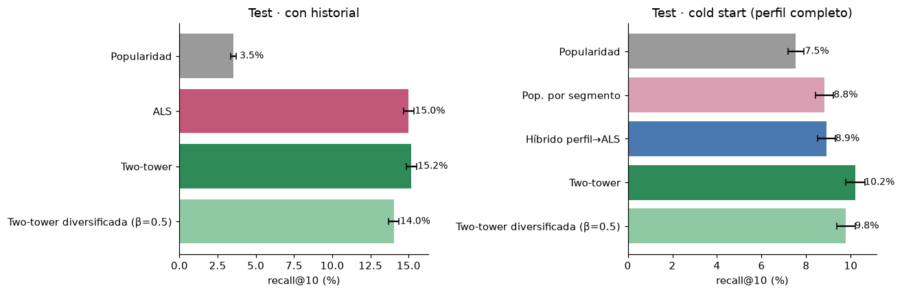
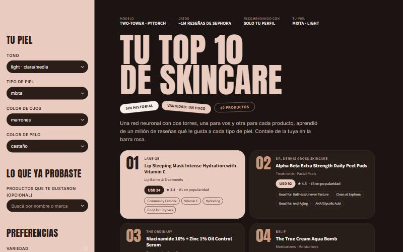
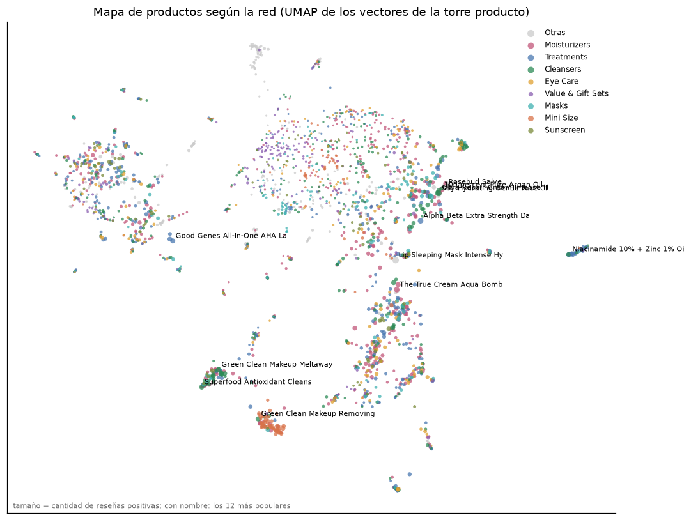

# Recomendador de Skincare

**Pregunta:** Si me decís tu tipo y tono de piel, ¿te puedo recomendar skincare que te vaya a gustar,
aunque nunca hayas reseñado nada? ¿Y funciona igual de bien para todos los tonos de piel?

Una red neuronal **two-tower** (persona ↔ producto) en PyTorch, entrenada con ~1 millón de reseñas de Sephora,
comparada contra baselines clásicos bien ajustados y con un análisis de *fairness* por tono de piel.

📖 **La historia, con gráficos interactivos:** [¿Tu piel alcanza?](https://candeperles.github.io/recomendador-skincare/) (`docs/index.html`)

🧴 **Probá la demo:** [tu top 10 de skincare](https://recomendador-skincare-cqmezmxdhuk5jyetynpfza.streamlit.app/)

## Resultados en 30 segundos

Evaluación final en **test** (datos que ninguna decisión vio), recall@10:

| Escenario | Mejor baseline | **Two-tower** | Diferencia (±95%) | |
|---|---|---|---|---|
| **Persona nueva** (solo perfil de piel) | Híbrido perfil→ALS: 8,9% | **10,2%** | +1,3 ± 0,3 | **la red gana** (+15%) |
| **Con historial** de reseñas | ALS: 15,0% | **15,2%** | +0,2 ± 0,3 | empate |



**Lo que encontré:**

1. **Sí se puede recomendar solo con el perfil de piel**, y la red lo hace mejor que cualquier alternativa simple. Con historial, el historial ya dice casi todo y la red empata con el ALS.
2. **Cada pieza de la red tiene su escenario** (ablaciones): el perfil solo sirve sin historial; el historial es la pieza clave; los ingredientes, la marca y los *highlights* son lo que permite alcanzar al ALS; el ID del producto casi no hace falta, así que la red puede recomendar productos nuevos.
3. **El perfil le sirve más que a nadie a los tonos oscuros.** Sin historial, conocer el tono le suma +3,7 puntos al grupo *oscuro*. No hay una brecha en contra de ningún grupo de tono.
4. **Un sesgo escondido en los datos.** Las pocas personas con tono *dark*, *porcelain* u *olive* reseñan casi solo productos de dos marcas (Caudalie y KORRES). La red "acierta" mucho con ellas, pero aprendiendo un artefacto de los datos, no lo que necesita su piel.
5. **La red organizó el catálogo por marca, no por tipo de producto**: las personas arman rutinas de marca.
6. **Se puede diversificar casi gratis**: penalizando un poco lo popular, la red muestra 40% más productos distintos sin perder acierto.
7. **Test existe por una razón**: la ventaja con historial que vi en validación (+1,6 puntos) no se sostuvo, y un error de protocolo apareció justo porque test daba raro.

## La demo

Elegís tu tono, tipo de piel, ojos y pelo (y, si querés, productos que ya te gustaron) y la red te devuelve tu top 10, con un control de "variedad".

**Online:** https://recomendador-skincare-cqmezmxdhuk5jyetynpfza.streamlit.app/ · **Local:**

```
.venv\Scripts\streamlit run web/app.py
```

La demo solo necesita `web/assets/` (catálogo, categorías de perfil y pesos del modelo, ~2,5 MB, generados con
`scripts/export_demo.py`), así que corre sin los datos de reseñas. Para publicarla en Streamlit Community Cloud:
archivo principal `web/app.py` (usa `web/requirements.txt`, con PyTorch para CPU).



## Los notebooks, en orden

| Notebook | Qué hay |
|---|---|
| [00 · Revisión de datos](notebooks/00_revision_datos.ipynb) | ¿Los datos aguantan el proyecto? Reseñas por persona, tonos, ratings, fechas |
| [01 · Splits](notebooks/01_splits.ipynb) | Qué es "le gustó", cómo separar train / validación / test sin fugas (con historial y cold start) |
| [02 · Baselines](notebooks/02_baselines.ipynb) | Popularidad, popularidad por segmento, ALS, híbrido perfil→ALS. Hallazgo: el "reloj escondido" de los perfiles incompletos |
| [03 · Two-tower](notebooks/03_two_tower.ipynb) | La red: diseño, entrenamiento, grilla, resultados por tono, qué aprendió |
| [04 · Experimentos](notebooks/04_experimentos.ipynb) | Ablaciones, semillas, fairness en profundidad, sesgo de popularidad, **test final** |
| [05 · Contarlo](notebooks/05_contarlo.ipynb) | Mapa UMAP de productos y la historia del proyecto en gráficos |



## Datos

Kaggle, ["Sephora Products and Skincare Reviews"](https://www.kaggle.com/datasets/nadyinky/sephora-products-and-skincare-reviews) (nadyinky). No se incluyen en el repositorio: hay que descargarlos y descomprimirlos en `data/raw/sephora/`.
- `product_info.csv`: 8.494 productos (precio, marca, categoría, ingredientes, highlights)
- `reviews_*.csv`: ~1,09 millones de reseñas de skincare, 503.216 personas, 2.351 productos reseñados

Características clave: el 58% de las personas tiene **una sola** reseña (el *cold start* es la norma), los tonos están muy desbalanceados (light/fair/lightMedium dominan; *dark* tiene ~500 reseñas) y el 82% de los ratings son ≥4.

## Cómo reproducirlo

```
python -m venv .venv
.venv\Scripts\pip install -r requirements.txt
```

1. Correr los notebooks 00 y 01 (generan `data/interim/` y `data/processed/`).
2. Notebooks 02 y 03 (el 03 entrena la red: ~25 min en CPU).
3. `python scripts/grid_two_tower.py` (opcional, ~2 h), `python scripts/train_ablations.py` (~1 h en paralelo) y `python scripts/train_final.py` (~20 min).
4. Notebooks 04 y 05, y la demo.

## Estructura

```
data/raw/sephora/   datos originales (no se suben)
data/processed/     splits listos para modelar (no se suben)
notebooks/          00 a 05, en orden
src/                datos, splits, evaluación, baselines, red two-tower
scripts/            entrenamientos largos (grilla, ablaciones, modelo final)
models/             pesos entrenados (no se suben)
reports/            tablas de resultados y gráficos
web/                demo en Streamlit
docs/               otras ideas (ej. idea_dupes_labiales.md)
```

## Bitácora: el plan y las decisiones

### Paso 0 · ¿Los datos aguantan el proyecto? ✅
- `00_revision_datos.ipynb`: reseñas por persona y por producto, faltantes, tonos, ratings, fechas
- Positivo = rating ≥4; 5 grupos de tono (claro / light / medio / tan / oscuro) porque porcelain, olive, dark y ebony son muy chicos

### Paso 1 · Definir el problema ✅
- Split con historial por días: test = 1 producto del último día, val = 1 del anteúltimo, train = el resto (41.509 personas con positivos en ≥3 días)
- Split cold start: 10% de las personas fuera de train, mitad val y mitad test (~21.500 cada uno)
- 7 chequeos automáticos (sin fugas, orden temporal, reproducible) en `src/splits.py`

### Paso 2 · Baselines ✅
- Evaluación común en `src/evaluate.py`: Recall@10, NDCG@10, cobertura, desglose por tono
- Popularidad · popularidad por segmento · ALS (`implicit`) · híbrido perfil → ALS (reemplaza a LightFM, que no se instala en Windows)
- Validación: con historial, **ALS 16,9%**; cold start con perfil completo, **9,2–9,3%**
- Hallazgo: los perfiles incompletos son reseñas viejas y más fáciles de adivinar → la comparación en cold start es sobre perfil completo

### Paso 3 · Two-tower ✅
- Torre persona: tono, tipo de piel, ojos, pelo + promedio de los vectores del historial
- Torre producto: ID, marca, categorías, precio, ingredientes y highlights (aprendidos dentro de la red)
- Softmax sobre todo el catálogo (con 2.351 productos no hace falta muestrear negativos)
- Validación: **18,5%** con historial, **10,3%** en cold start

### Paso 4 · Experimentos y test ✅
- Ablaciones, 3 semillas (el recall varía 0,03 puntos), fairness por grupo y por cada uno de los 13 tonos, penalización por popularidad
- Test re-entrenando todo con lo que no es test: **10,2%** en cold start (gana), **15,2%** con historial (empate)

### Paso 5 · Contarlo ✅
- Demo en Streamlit (`web/app.py`), mapa UMAP de productos y resumen en `notebooks/05_contarlo.ipynb`

### Ideas para seguir
- Darle más peso a lo reciente en el historial (atención o descuento por antigüedad): la mejora más prometedora con historial
- Marcar o filtrar las reseñas con origen sesgado antes de entrenar
